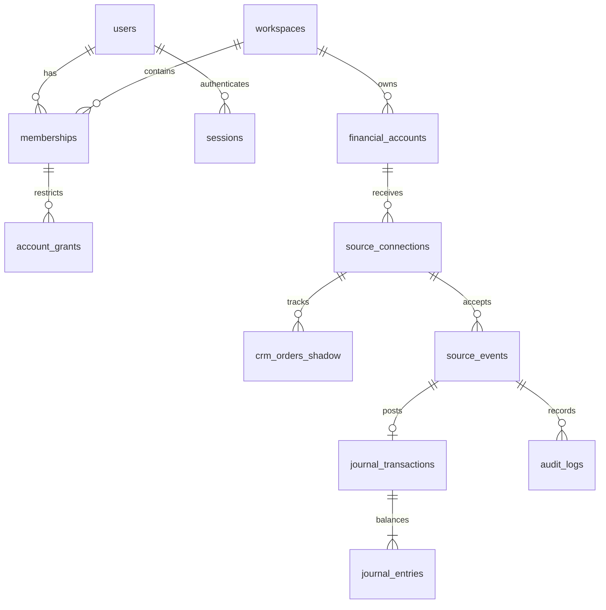

# CRM receiver v1 — phase 2A

This PR adds the **receiver and management journal**, not the CRM producer,
login UI, cloud database provisioning or bank matching. The receiver stays OFF
in the deployed Worker. Production is explicitly refused by this release.
CRM files and databases are unchanged. This branch builds on PR #1.

## Transport and identity

`POST /v1/crm/events`, HTTPS, `Content-Type: application/json`, at most 16 KiB
of strict UTF-8. No query string. No customer names, addresses, card details,
receipt files or bank account numbers. Unknown payload fields are rejected.

Required headers: `X-NW-Connection`, `X-NW-Key-Id`, `X-NW-Timestamp` (Unix
seconds), `X-NW-Nonce` (UUID), `X-NW-Signature` (lowercase SHA-256 HMAC hex).
Sign the UTF-8 encoding of these newline-separated values, with no final newline:

```text
v1
POST
/v1/crm/events
<connection>
<key-id>
<timestamp>
<nonce>
<lowercase SHA-256 of the exact request-body bytes>
```

The HMAC secret is decoded from hex to bytes, not used as a hex string.
`CRM_SERVICE_KEYS` is a server-only JSON object keyed by key ID; each entry
has `connectionId`, `secret` (32–64 random bytes encoded as hex), `notBefore`
and `expiresAt` (Unix seconds). Overlapping key lifetimes permit rotation.
Web Crypto verifies signatures. Timestamps tolerate ±300 seconds. The database
also checks time and durably rejects nonce reuse. A retry uses a new timestamp,
nonce and signature but the **same event ID and identical body bytes**.

The database connection record chooses workspace and financial account.
Neither can be selected by a request payload. Provision only the `nestwise_api`
role to the Worker; it cannot read or write tables directly.

## Event envelope

All events require:

| Field | Meaning |
|---|---|
| `schema_version` | Exactly integer `1` |
| `source_event_id` | Stable UUID, unique within the CRM connection |
| `source_order_id` | Stable order identifier, 1–128 ASCII identifier characters |
| `source_fact_id` | Stable financial-fact/assertion identifier, unique within the connection |
| `order_revision` | Contiguous positive integer per order, beginning at 1 |
| `type` | One of the types below |
| `currency` | `USD` in v1 |
| `occurred_at` | UTC ISO timestamp of the source fact, not delivery time |
| `paid_at` | Actual UTC payment/refund timestamp; null for noncash assertions |

Amounts are JSON safe integers in cents, never decimal dollars or strings.
Maximum individual amount is 9,007,199,254,740,991 cents. Summaries returned
from SQL use decimal strings so aggregate values cannot lose precision.

| Type | Additional fields / effect |
|---|---|
| `job.payment_recorded` | Positive `amount_cents`; debit clearing, credit receipts |
| `job.part_cost_recorded` | Positive amount; `settlement: paid` or `accrued`; debit parts cost, credit clearing or parts payable |
| `job.customer_refund_issued` | Positive amount and `reference_event_id` of a posted payment; debit refunds, credit clearing |
| `job.supplier_credit_received` | Positive amount and latest posted parts-cost reference; reverse the original cost/settlement side |
| `job.processor_fee_recorded` | Positive amount; debit fees, credit clearing |
| `job.processor_fee_refunded` | Positive amount and fee reference; reverse the fee |
| `job.cost_corrected` | Replacement `amount_cents` (zero allowed), previous cost/correction reference; append only the delta |
| `job.financials_finalized` | `totals` object; assertion only, never another revenue posting |
| `job.reopened` | Assertion only |
| `job.voided` | Allowed only when every account balance for that order is zero |

The two fee events are explicit v1 extensions to the supplied event list.
Finalization totals contain exactly `payments_cents`, `refunds_cents`,
`parts_net_cents`, `fees_net_cents`. These must equal the existing journal.
All monetary events require `paid_at`, except accrued costs, corrections and
supplier credits against accrued payables (which require null `paid_at`).
Accrued costs require null `paid_at`. Assertions require null `paid_at`.
Settling an accrued payable is not supported yet and must not be represented
as a second cost event. Corrections after supplier credits require separate
review; they cannot silently replace a credited cost. No tax/COGS deduction
policy is inferred by this management ledger.

## ACK, conflicts and recovery

- `202`: the transaction committed. `accepted:true`, `duplicate`, `event_id`,
  and `status` are returned. Receipt is durable even if status is `waiting`
  or `needs_review`; ACK does **not** mean posted.
- `waiting`: predecessor missing. Later arrival drains contiguous revisions.
  Up to 100 revisions drain per order in one call; `process_pending()` catches
  up further batches (20 eligible orders per invocation).
- `posted`: balanced monetary entries appended.
- `asserted`: nonfinancial assertion applied.
- `needs_review`: invalid reference, excessive refund, snapshot mismatch,
  void with remaining financial balances, or unsupported fact. The order stops
  before that revision. Later events remain durable and waiting.
- `409`: reused nonce, changed body for an existing event, or competing
  event/fact/revision identity. Do not retry a semantic conflict automatically.
- `400/413/415`: contract/body/type rejection; repair the producer.
- `401`: invalid or expired service identity.
- `503`: no ACK. Retry at least once with exponential backoff and jitter.

No API can edit an accepted fact or skip a revision. Resolution of a review
item needs an audited operator workflow in a subsequent PR. This release does
not pretend that a `needs_review` queue is a complete CRM transport DLQ.
Before activating the sender, implement transactional CRM outbox, bounded
delivery attempts, Retry/Failed/DLQ UI, scheduling, reconciliation cursor and
owner-approved historical dry-run. Keep its feature flag OFF by default.

## Human read API

`GET /v1/workspaces/{workspace}/accounts/{account}/journal` takes a bearer
session token. Only its SHA-256 is sent to PostgreSQL. Expired/revoked sessions
fail with 401; inaccessible accounts are hidden with 404. Membership plus
either `all_accounts` or an explicit account grant is required, including for
accountants. Results contain the most recent 100 transactions. No browser
session-creation endpoint is exposed. Login, pagination and mobile wiring
remain subsequent work; never distribute a manually seeded test session.

## Data relationships



Financial entries and audit history cannot be updated/deleted, and no entries
can be added to a transaction after its creating database transaction commits.
Bank imports remain evidence-only; this PR does not implement matching or
claim that a deposit was reconciled.
